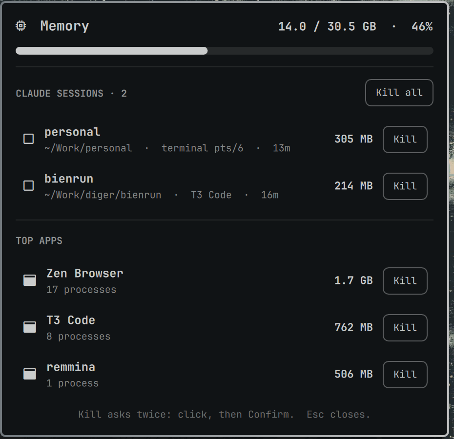

# RAM Kill for Omarchy

A RAM widget for the [Omarchy](https://omarchy.org) bar. Click it to see where
your memory went and to kill things, without having to read through btop.



- **Memory**: used / total, with a bar that turns red above 85%.
- **Claude sessions**: every running Claude Code instance gets its own row,
  with its project folder, where it runs (a terminal, T3 Code, ...), its age
  and the RAM it uses, including the MCP servers and tools it started.
  Kill one, tick a few and kill the selected ones, or kill them all.
- **Top apps**: the biggest apps you launched, grouped by app, so all of a
  browser's processes count as one row.

Every kill asks twice: click **Kill**, then **Confirm?** within 3 seconds.
A kill takes down the process and everything it spawned (SIGTERM, then
SIGKILL after 3s).

Only your own apps show up. Hyprland, the Omarchy shell, audio, portals,
keyring and other session services are never listed and can't be killed
from here.

## Install

```bash
omarchy plugin add https://github.com/luiscf1226/omarchy-ram-kill.git --enable
```

Requires `python3`, which Omarchy already ships.

## Command line

The helper script also works on its own:

```bash
python3 ram-kill list          # apps by memory, biggest first
python3 ram-kill json          # what the panel shows, as JSON
python3 ram-kill kill <pid>... # kill PIDs and their children
```

## License

MIT
